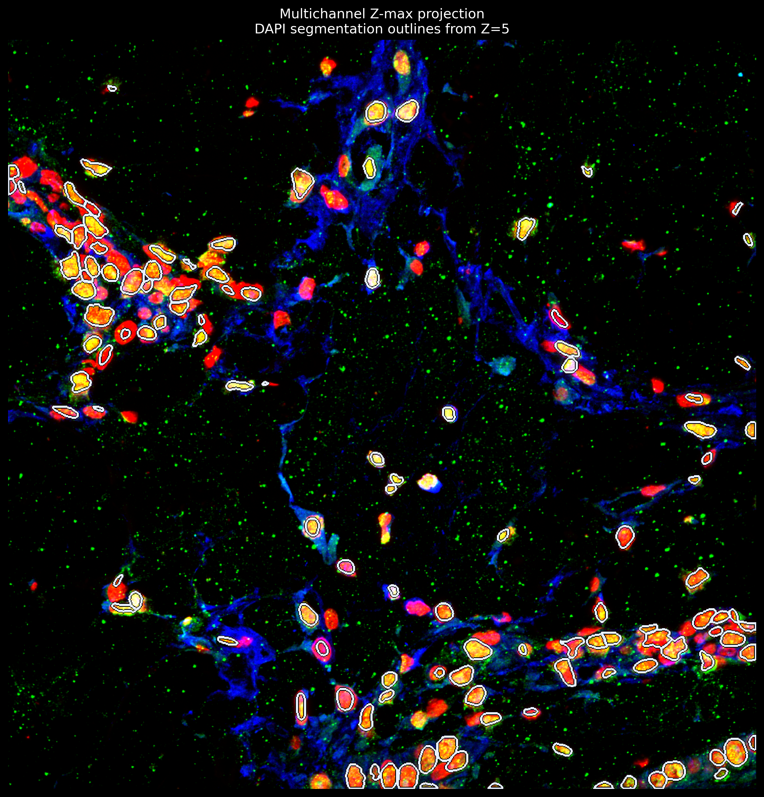

# OIR Microscopy: Exploratory Nuclear Segmentation

A small Python notebook for exploring multichannel Olympus confocal microscopy stacks and producing preliminary nuclear segmentation overlays with pretrained Cellpose.

The project demonstrates image loading, acquisition metadata inspection, fluorescence visualization, and segmentation with an existing pretrained model. No model is trained from scratch.

## Workflow

1. Load Olympus OIR data using `oirfile`.
2. Inspect acquisition metadata, array axes, and spatial calibration.
3. Establish the DAPI channel from acquisition metadata.
4. Visualize individual channels, optical sections, and maximum-intensity projections.
5. Segment a selected DAPI optical section using Cellpose's pretrained `nuclei` model.
6. Review boundaries on the DAPI image and a multichannel composite.
7. Export label masks, figures, and segmentation parameters.

## Example visualization

**Figure:** Multichannel maximum-intensity projection with preliminary segmentation boundaries from one optical section, Z=5 (zero-based indexing). CH1, CH2, and CH3 are assigned to red, green, and blue; CH4 is omitted. Cool ivory boundaries with black backing improve visibility. Display colors do not establish biological marker identity.
